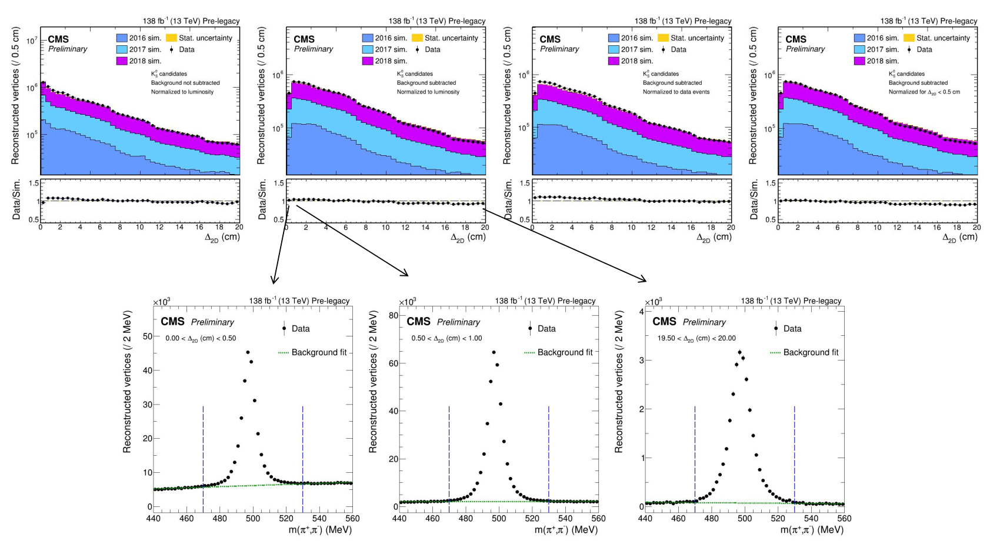

# Analysis code for displaced vertexing study with K-short mesons

### Introduction
This is the analysis code behind the study presented in [AN-20-111](https://icms.cern.ch/tools/publications/notes/entries/AN/2020/111) (CMS internal) and [DP-2024-010](https://cds.cern.ch/record/2890104) (public). Both references introduce the topic and describe the method.

In short: K0S → π+π− decays (and Λ → pπ) provide a clean source of genuinely displaced vertices.
The number of reconstructed K0S mesons is compared between data and simulation as a function of the radial displacement Δ2D of the vertex from the beam line, in a clean Z → μ+μ− event sample.
After normalizing simulation to data at small displacement (Δ2D < 0.5 cm), any remaining data/simulation trend with displacement measures how well simulation models displaced track and vertex reconstruction.

The study was originally performed on Run 2 (pre-UL and UL) and is being extended to Run 3 (2022–2025).

### Prerequisites
This code runs on ROOT ntuples (flat trees with variable-length arrays as branches) produced from MiniAOD with a custom ntuplizer that includes a dedicated V0 reconstruction module.

- **Run 3 (current):** the ntuplizer is the CMSSW package `V0Analysis/V0Analyzer`, kept in its own repository next to this one in the same CMSSW area (`$CMSSW_BASE/src/V0Analysis/V0Analyzer`). It writes the tree `blackJackAndHookers/blackJackAndHookersTree`.
- **Run 2 (legacy):** the `ntuplizer` directory contains, for reference only, the `heavyNeutrino/multilep` ntuplizer that was used for the Run 2 version of the study. It is not used for Run 3.

The ntuplizer output must match the branches that `skimming/skim_ztomumu.cc` reads (lepton, trigger, jet and b-tagging branches, and the array sizes `nL_max`/`nJets_max`).

### Workflow
Starting from the ntuples produced by the ntuplizer (usually with CRAB), perform these steps in order:
1. **skimming** (`skimming/`): select clean Z → μ+μ− events (two medium muons, dimuon trigger, |mμμ − mZ| < 10 GeV, b-jet veto) and drop unneeded branches.
2. **v0building** (`v0building/`): apply the V0 selection and write flat trees of K0S (`laurelin`) and Λ (`telperion`) candidates with their properties.
3. **analysis** (`analysis/`): fill data and simulation histograms (pileup reweighting, normalization, optional background subtraction from invariant-mass fits) and make data vs. simulation plots. The entry point is `mcvsdata_submit.py`.

Supporting directories:
- `fitting/`: invariant-mass peak fitting and counting (`count_peak.py`), see also `ADAPTIVE_STRATEGY_SUMMARY.md`.
- `plotting/`: plotting scripts (data vs. simulation, 1D and 2D).
- `reweighting/pileup/`: pileup profiles and the pileup reweighter for each year/era.
- `samplelists/`: lists of ntuple directories per campaign.
- `tools/`: shared helpers (job submission, luminosity, histograms, fits).
- `dps/`: helpers for the DPS note approval.
- `efficiencystudy/`: placeholder for an absolute-efficiency study (not pursued yet).
- `oldcode/`: earlier code, kept for reference only.

### Main results
The main results take the form summarized in this figure:

Distributions of the number of reconstructed K mesons as a function of radial displacement are compared between data and simulation. Particular care goes into the normalization and into background subtraction from fits to the invariant-mass spectrum. For more details, see the AN and DP linked above.
